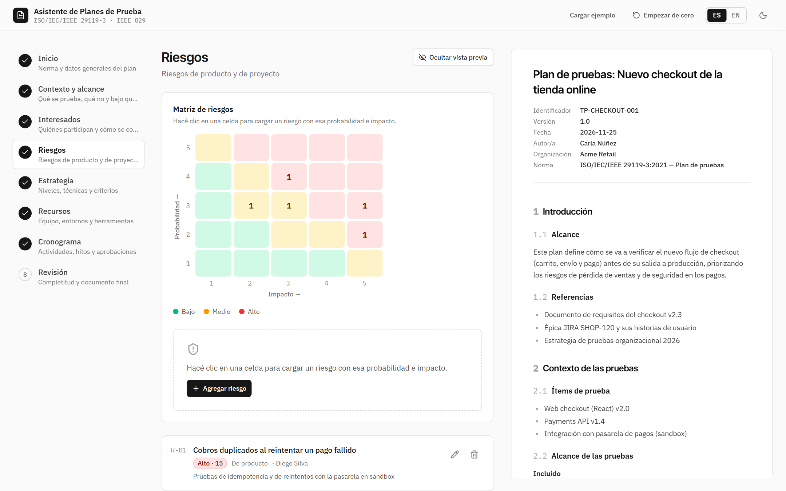
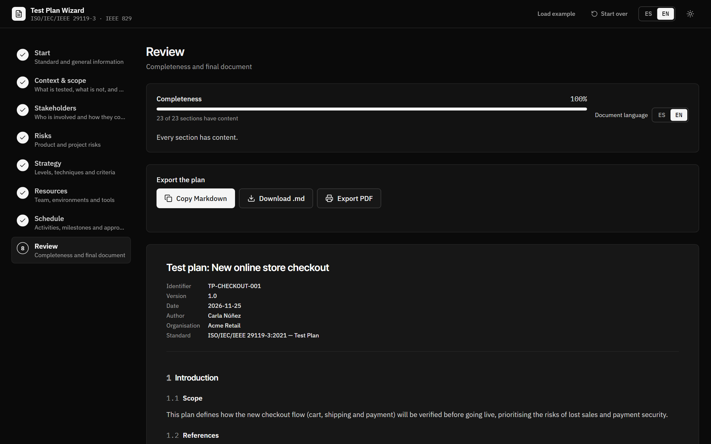
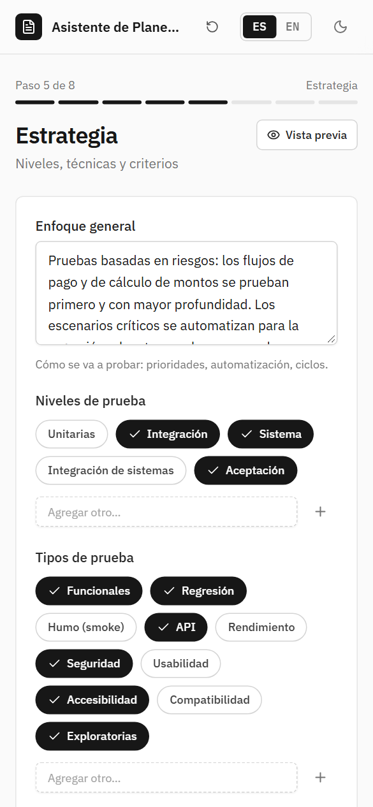

# Asistente de Planes de Prueba

[](https://github.com/anagonzalezlame/test-plan-wizard/actions/workflows/ci.yml)


[English](README.md) · **Español**

Un asistente paso a paso que te hace las preguntas clave sobre **alcance, interesados, riesgos, estrategia, recursos y cronograma**, y con las respuestas arma un plan de pruebas con la estructura de **ISO/IEC/IEEE 29119-3** o **IEEE 829-2008**, listo para copiar en Markdown o exportar a PDF.

Funciona por completo en el navegador: sin cuentas ni servidor, y tus datos no salen de tu computadora.

**▶ Probalo en vivo: [wiz.anagonzalez.uy](https://wiz.anagonzalez.uy)**



## Por qué

Escribir un plan de pruebas desde cero lleva tiempo, y es fácil olvidarse de secciones que las normas esperan, como los criterios de suspensión, los datos de prueba o los riesgos de proyecto. Esta herramienta te guía por cada sección, te muestra el documento en vivo y te dice qué falta completar.

## Funcionalidades

- **Dos normas con las mismas respuestas.** Podés cambiar en cualquier momento entre la estructura de *Test Plan* de ISO/IEC/IEEE 29119-3 y la de *Level Test Plan* de IEEE 829-2008.
- **Matriz de riesgos interactiva.** Hacés clic en una celda de la matriz 5×5 de probabilidad × impacto y cargás el riesgo. Cada riesgo recibe un código (R-01, R-02…) y se ordena por severidad. El nivel de riesgo es el único color de la interfaz, para que resalte.
- **Vista previa y completitud.** El documento se actualiza mientras escribís. En el paso de revisión aparecen las secciones vacías, cada una con un enlace al paso donde se completa.
- **Exportación:** copiar en Markdown, descargar un `.md` o imprimir a PDF con un diseño propio para impresión (A4, colores claros, tablas que no cortan filas).
- **Bilingüe.** La interfaz y el documento pueden estar en español o en inglés, de forma independiente. Podés completar el asistente en español y exportar el plan en inglés.
- **Autoguardado** en el `localStorage` del navegador.
- **Plan de ejemplo.** Con un clic cargás un plan completo de un checkout de e-commerce.
- **Accesible.** Navegable con teclado, foco visible, controles etiquetados, errores anunciados a lectores de pantalla, respeta `prefers-reduced-motion` y se adapta hasta 320 px de ancho.

| Revisión y exportación (tema oscuro) | Celular |
| --- | --- |
|  |  |

## Cómo levantarlo en local

Requisitos: [Node.js](https://nodejs.org/) 20.19 o superior y npm.

```bash
git clone https://github.com/anagonzalezlame/test-plan-wizard.git
cd test-plan-wizard
npm install
npm run dev
```

Después abrí <http://localhost:5173>.

Para generar una versión estática (se puede publicar en GitHub Pages, Netlify, Cloudflare Pages o cualquier hosting estático):

```bash
npm run build     # genera dist/
npm run preview   # sirve el build en local
```

## Cómo usarlo

1. **Inicio:** elegí la norma y completá el nombre del proyecto y el autor (obligatorios).
2. **Contexto y alcance:** ítems de prueba, funcionalidades incluidas y excluidas, supuestos y restricciones.
3. **Interesados:** quiénes participan y el plan de comunicación.
4. **Riesgos:** cargá los riesgos de producto y de proyecto desde la matriz.
5. **Estrategia:** enfoque, niveles, tipos, técnicas de diseño, criterios de entrada, salida, suspensión y reanudación, entregables y métricas. Podés elegir de los catálogos o agregar los tuyos.
6. **Recursos:** equipo y responsabilidades, capacitación, entornos, herramientas y datos de prueba.
7. **Cronograma:** actividades con estimación de esfuerzo (el total se calcula solo), hitos y aprobadores.
8. **Revisión:** controlá la completitud, elegí el idioma del documento y exportá.

> **Sobre el cumplimiento.** El documento generado sigue la estructura de secciones del plan de pruebas de cada norma. Que un plan *cumpla* con la norma depende también de su contenido y del proceso de tu organización, así que revisalo como cualquier otro entregable.

## Calidad

Es un proyecto de portfolio de QA, así que está probado como esperaría que se pruebe cualquier producto:

| Capa | Herramienta | Qué cubre |
| --- | --- | --- |
| Estática | TypeScript (strict), oxlint | Tipos y reglas de lint, sin advertencias |
| Unitarias | Vitest | Mapeo de las plantillas en ambas normas e idiomas, generación y escape de Markdown, puntaje de riesgos, nombres de archivo |
| Integración | Testing Library | Validación del asistente, edición de listas, alta de un riesgo desde la matriz, cambio de idioma del documento |
| End-to-end | Playwright | Campos obligatorios, persistencia al recargar, portapapeles y descarga `.md` en ES y EN, diseño de impresión y PDF, sin scroll horizontal en ningún paso a 375 px |

Cada push y pull request corre toda la suite en GitHub Actions.

```bash
npm run lint
npm test            # unitarias + integración
npx playwright install chromium   # solo la primera vez
npm run e2e         # end-to-end (compila y levanta la app)
npm run screenshots # regenera las capturas del README (con la app levantada; usá BASE_URL)
```

## Stack

Vite · React 19 · TypeScript · Tailwind CSS v4 · Zustand · React Hook Form + Zod · Motion · Lucide · Vitest · Testing Library · Playwright

La estructura de carpetas está detallada en el [README en inglés](README.md#tech-stack). Las plantillas son funciones puras, así que sumar otra norma u otro formato de salida implica agregar un archivo y sus pruebas.

## Sobre mí

Soy **Ana González Lamé**, Senior QA Analyst de Uruguay (ISTQB CTFL), con más de diez años en tecnología. Trabajo en estrategia de pruebas, testing exploratorio y funcional, escenarios BDD en Gherkin y pruebas de API. Hice esta herramienta para que planificar las pruebas sea más rápido y consistente en los equipos con los que trabajo.

🟢 **Disponible para posiciones de QA remotas.** Hablemos: [LinkedIn](https://www.linkedin.com/in/anagonzalezlame/) · [anagonzalez.uy](https://www.anagonzalez.uy) · [CV interactivo](https://www.anagonzalez.cv)

## Contribuir

Los issues y pull requests son bienvenidos. Antes de abrir un PR, corré `npm run lint && npm test`.

## Licencia

[MIT](LICENSE) © 2026 Ana González Lamé
