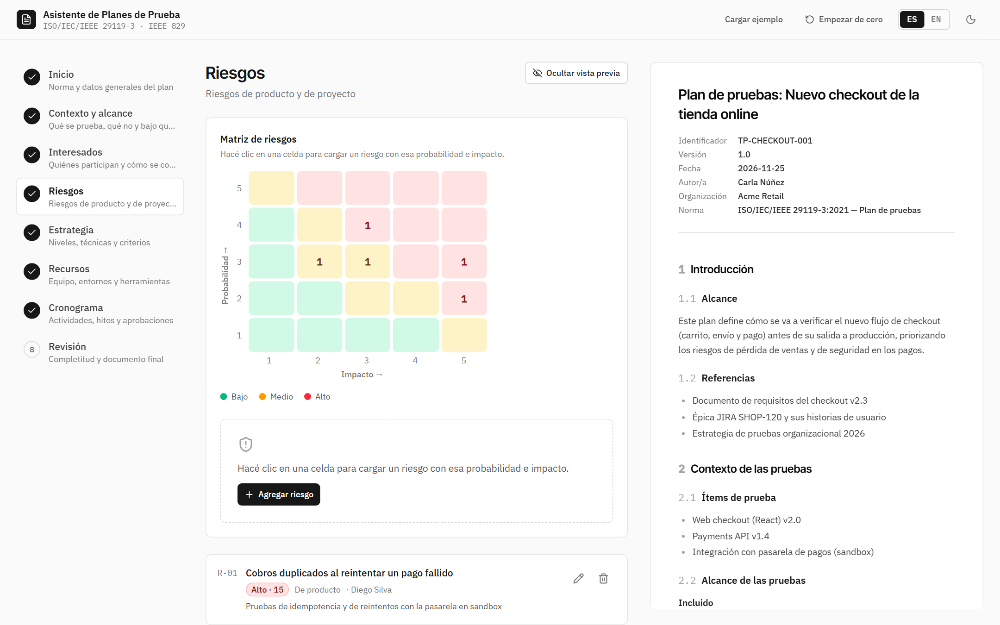
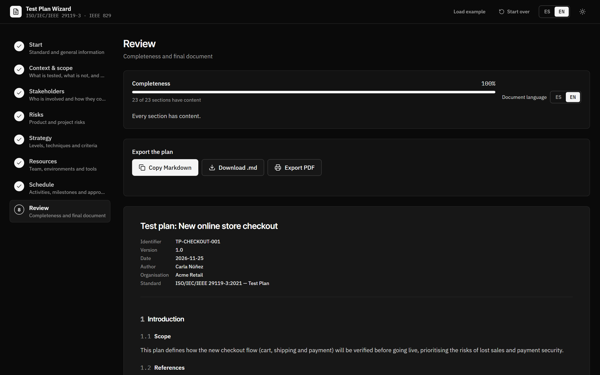
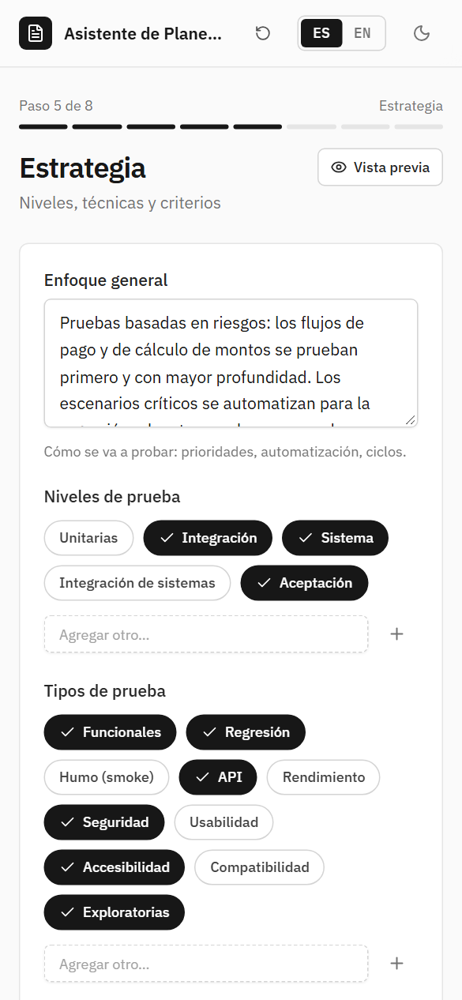

# Test Plan Wizard

[](https://github.com/anagonzalezlame/test-plan-wizard/actions/workflows/ci.yml)


**English** · [Español](README.es.md)

A step-by-step wizard that asks the key questions about **scope, stakeholders, risks, strategy, resources and schedule**, and turns the answers into a test plan structured after **ISO/IEC/IEEE 29119-3** or **IEEE 829-2008**, ready to copy as Markdown or export as PDF.

It runs entirely in the browser: no account, no backend, and your data never leaves your machine.

**▶ Try it live: [wiz.anagonzalez.uy](https://wiz.anagonzalez.uy)**



## Why

Writing a test plan from a blank page is slow, and it is easy to forget sections that the standards expect, such as suspension criteria, test data needs or project risks. This tool walks you through every section, shows a live preview of the document and tells you exactly what is still missing.

## Features

- **Two standards, one set of answers.** Switch between the ISO/IEC/IEEE 29119-3 *Test Plan* outline and the IEEE 829-2008 *Level Test Plan* outline at any time.
- **Interactive risk matrix.** Click a cell of the 5×5 probability × impact matrix to log a risk. Risks get codes (R-01, R-02…) and are ranked by severity. Risk level is the only colour in the UI, so it stands out.
- **Live preview and completeness meter.** See the document as you type. The review step lists every empty section with a link to the step where you fill it in.
- **Export:** copy as Markdown, download a `.md` file, or print to PDF with a dedicated print layout (A4, light colours, tables that never split a row).
- **Bilingual.** Interface and document in Spanish or English, independently. You can fill the wizard in Spanish and export the plan in English.
- **Autosave.** Progress is stored in your browser's `localStorage`.
- **Example plan.** One click loads a complete e-commerce checkout plan to explore the tool.
- **Accessible.** Keyboard navigable, visible focus, labelled controls, errors announced to screen readers, `prefers-reduced-motion` respected, and responsive down to 320 px.

| Review & export (dark theme) | Mobile |
| --- | --- |
|  |  |

## Getting started

Requirements: [Node.js](https://nodejs.org/) 20.19 or later and npm.

```bash
git clone https://github.com/anagonzalezlame/test-plan-wizard.git
cd test-plan-wizard
npm install
npm run dev
```

Then open <http://localhost:5173>.

To build a static version (it can be hosted on any static host such as GitHub Pages, Netlify or Cloudflare Pages):

```bash
npm run build     # output in dist/
npm run preview   # serve the build locally
```

## How to use it

1. **Start:** choose the standard and fill in the project name and author (both required).
2. **Context & scope:** test items, features in and out of scope, assumptions and constraints.
3. **Stakeholders:** who is involved and the communication plan.
4. **Risks:** add product and project risks from the matrix.
5. **Strategy:** approach, levels, types, design techniques, entry, exit, suspension and resumption criteria, deliverables and metrics. Pick from the catalogues or add your own.
6. **Resources:** team and responsibilities, training, environments, tools and test data.
7. **Schedule:** activities with effort estimates (the total is calculated), milestones and approvers.
8. **Review:** check completeness, choose the document language and export.

> **Note on compliance.** The generated document follows the section structure of each standard's test plan. Whether a plan *conforms* to the standard also depends on its content and on your organisation's process, so review it like any other deliverable.

## Quality

Built as a QA portfolio project, so it is tested the way I would expect any product to be:

| Layer | Tooling | What it covers |
| --- | --- | --- |
| Static | TypeScript (strict), oxlint | Types and lint rules, zero warnings |
| Unit | Vitest | Template mapping for both standards and both languages, Markdown rendering and escaping, risk scoring, file naming |
| Integration | Testing Library | Wizard validation, list editing, creating a risk from the matrix, switching the document language |
| End-to-end | Playwright | Required fields, persistence after reload, clipboard and `.md` download in ES and EN, print layout and PDF generation, no horizontal overflow on any step at 375 px |

Every push and pull request runs the whole suite on GitHub Actions.

```bash
npm run lint
npm test            # unit + integration
npx playwright install chromium   # first time only
npm run e2e         # end-to-end (builds and serves the app)
npm run screenshots # regenerate README screenshots (needs the app running; set BASE_URL)
```

## Tech stack

Vite · React 19 · TypeScript · Tailwind CSS v4 · Zustand · React Hook Form + Zod · Motion · Lucide · Vitest · Testing Library · Playwright

```
src/
├── components/
│   ├── steps/      one component per wizard step
│   ├── risk/       risk matrix, form and styles
│   ├── preview/    document renderer
│   ├── export/     copy / download / print
│   ├── wizard/     header, stepper, navigation
│   └── ui/         buttons, fields, list and table editors
├── templates/      ISO 29119-3 and IEEE 829 outlines: pure (plan, lang) → sections
├── lib/            markdown, completeness, risk, export helpers
├── i18n/           UI and document strings (es, en)
├── store/          Zustand store with persistence
└── data/           catalogues and the example plan
```

Templates are pure functions, so adding another standard or output format means adding one file and its tests.

## About the author

I'm **Ana González Lamé**, a Senior QA Analyst from Uruguay (ISTQB CTFL) with over a decade in tech. I work on test strategy, exploratory and functional testing, BDD scenarios in Gherkin and API testing. I built this tool to make test planning faster and more consistent for the teams I work with.

🟢 **Open to remote QA roles.** Let's talk: [LinkedIn](https://www.linkedin.com/in/anagonzalezlame/) · [anagonzalez.uy](https://www.anagonzalez.uy) · [Interactive CV](https://www.anagonzalez.cv)

## Contributing

Issues and pull requests are welcome. Please run `npm run lint && npm test` before opening a PR.

## License

[MIT](LICENSE) © 2026 Ana González Lamé
